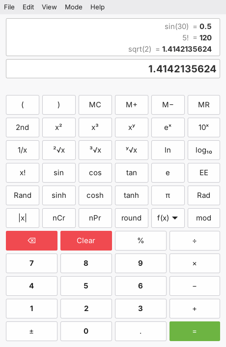
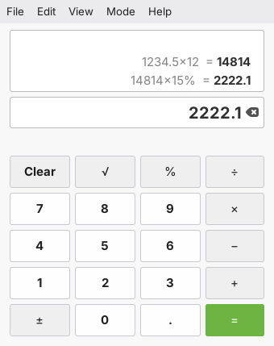
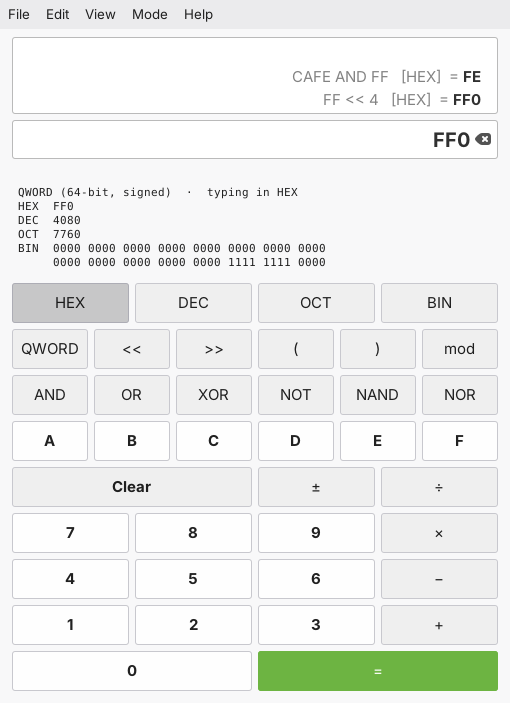
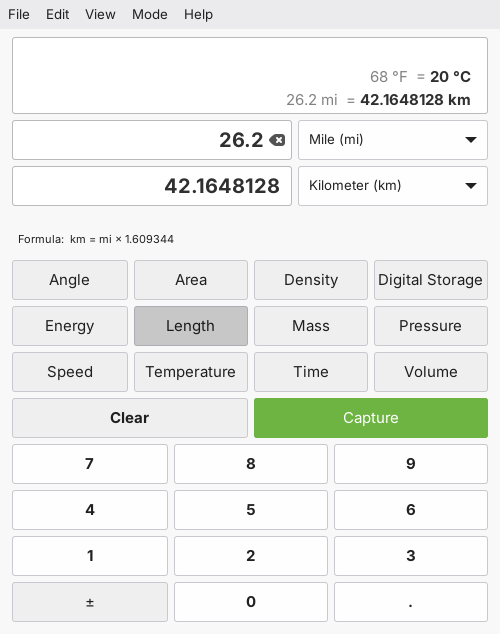

# Xcalculator

A calculator for Linux Mint and the Cinnamon desktop, made in the style of the
Mint X-Apps: a classic menubar, the system theme, and nothing that looks out of
place next to Xed or Xviewer.



## Modes

Choose a mode from the **Mode** menu (or Ctrl+Alt and the mode's first letter).

- **Basic**: everyday sums
- **Scientific**: powers, roots, trigonometry, logarithms, factorials, combinations, and a menu of more functions
- **Financial**: loans and savings (N, I/Y, PV, PMT, FV), cash flows (NPV, IRR), and depreciation
- **Programmer**: HEX, DEC, OCT, and BIN; word sizes from 8 to 64 bits; and bitwise operators
- **Unit Converter**: twelve categories, converted as you type
- **Currency Converter**: about 30 currencies, with exchange rates from the European Central Bank

Every answer goes into a history you can click to reuse. The history can be
printed like an adding-machine tape. With `python3-mpmath` installed, answers
can have up to 50 decimal places.

Press **F1** in the app for the documentation, and **Ctrl+F1** for the keyboard
shortcuts.

| Basic | Programmer | Unit Converter |
|---|---|---|
|  |  |  |

## Install

Download the `.deb` from the [latest release](https://github.com/xlcheese/Xcalculator/releases/latest)
and open it, or install it from a terminal:

```
sudo apt install ./xcalculator_0.9.3_all.deb
```

Xcalculator then appears in the menu under **Accessories**.

To run it without installing, you need Python 3 and GTK 3 (both come with Linux
Mint):

```
sudo apt install python3-gi python3-gi-cairo gir1.2-gtk-3.0 python3-mpmath iso-codes
python3 usr/lib/xcalculator/xcalculator.py
```

`python3-gi-cairo` is needed for printing, and `python3-mpmath` for more than
15 decimal places. Xcalculator still runs without them.

## The code

The program is in `usr/lib/xcalculator/`, one file for each part:

| File | What it holds |
|---|---|
| `xcalculator.py` | starts the program (one `Gtk.Application`, any number of windows) |
| `window.py` | the calculator window: menus, display, keypad layouts, keyboard, and clipboard |
| `basic.py` | typing a calculation and working it out, shared by Basic, Scientific, and Financial |
| `scientific.py` | Scientific's functions, the 2nd key, angle units, and the f(x) menu |
| `financial.py` | loans and savings, cash flows, amortization, and depreciation |
| `programmer.py` | bases, word sizes, and bitwise operators |
| `converter.py` | the Unit Converter and its exact conversion factors |
| `engine.py` | the arithmetic behind every mode, and how answers are written |
| `history.py` | the history above the display, and the saved history file |
| `printing.py` | printing the history as a calculator tape, and Print Preview |
| `preferences.py` | the Preferences window, and the settings it changes |
| `documentation.py` | the Documentation pages and the keyboard shortcuts |
| `config.py` | where settings are kept, and facts about the program |
| `i18n.py` | translations |
| `easter_egg.py` | try 5318008 = |

Each mode's keys live in a small class in its own file (`BasicMode`,
`ProgrammerMode` and so on); the window combines them.

## Build the package

```
sudo apt install debhelper gettext
dpkg-buildpackage -us -uc -b
```

The package is written to the folder above this one. `debian/rules` uses the
Makefile, which can also be used on its own:

- `make` compiles the translations and writes the menu entry
- `make install` installs everything under `/usr` (or `PREFIX`, into `DESTDIR`)
- `make pot` updates `po/xcalculator.pot` after any text in the program changes

## Translate

Xcalculator uses gettext. Spanish, French, German, and Brazilian Portuguese
are included as drafts that still need a review by native speakers:
corrections are very welcome.

To start a new language, for example Italian:

```
msginit -i po/xcalculator.pot -l it -o po/it.po
```

Translate the `msgstr` lines in `po/it.po` (with Poedit, or any text editor),
add `it` to `po/LINGUAS`, and run `make`. To try it from the source folder:

```
make
LANGUAGE=it python3 usr/lib/xcalculator/xcalculator.py
```

Currency names come already translated from the `iso-codes` package.

Calculator notation stays as it is: sin, HEX, NPV, MR, and the like are the same
in every language. Text in braces, such as `{mode}`, and markup such as
`<b>…</b>` must be kept exactly.

## License

Copyright © 2026 Wesley Hayslip

Xcalculator is free software: you can redistribute it and/or modify it under
the terms of the GNU General Public License as published by the Free Software
Foundation, either version 3 of the License, or (at your option) any later
version. See [LICENSE](LICENSE).

Developed with the help of Claude, an AI assistant by Anthropic.
